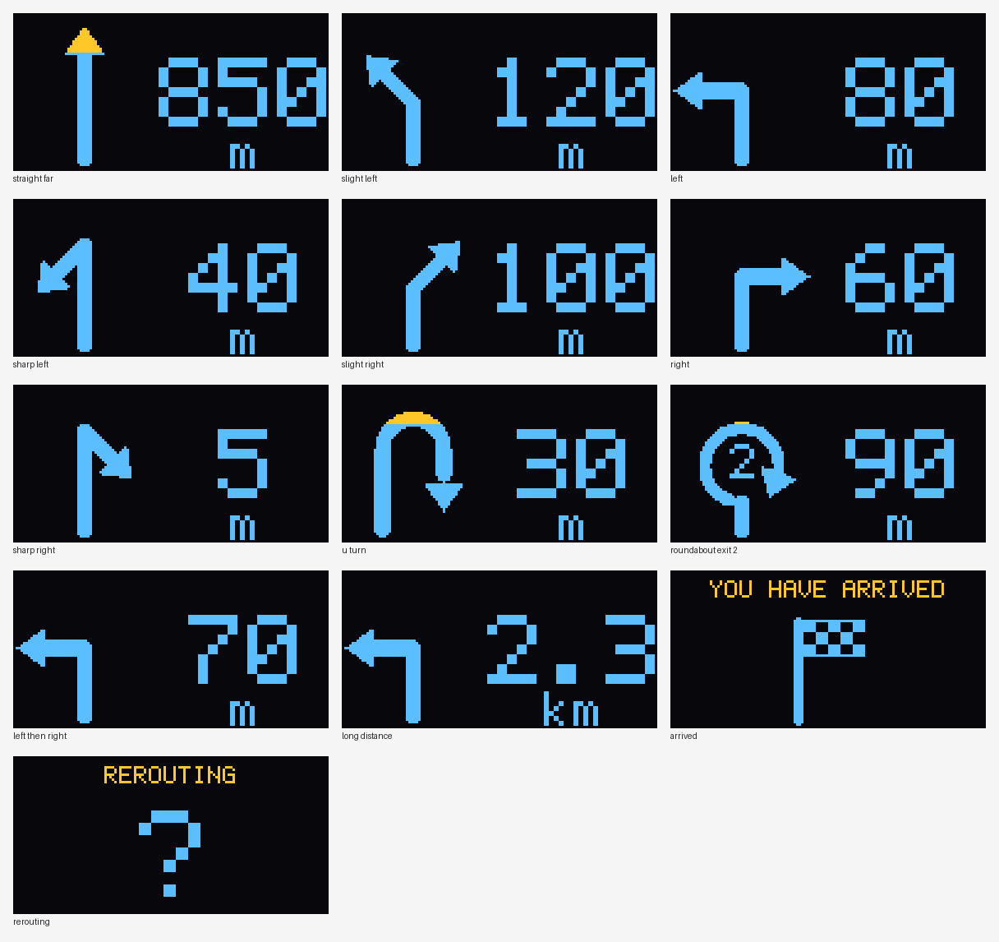

# Bike Nav

A cycling navigation system for a bike. A phone app works out the route and sends each turn over Bluetooth to a small OLED screen on the handlebars. The screen shows a big arrow for the next turn and how far away it is, and flashes when the turn is 5 m away.



## Where each part runs

| Folder | Runs on | What it is |
|--------|---------|------------|
| [`phone/app/`](phone/app/README.md) | Android phone | Flutter app: search for a destination, see the route on a Google map, ride with turn-by-turn navigation. Has a Simulate button for testing indoors. |
| [`phone/navigation/`](phone/navigation/README.md) | Android phone (inside the app) | The navigation logic: gets cycling routes from OpenRouteService, tracks the rider along the route, reroutes when they go off it, and draws the handlebar screen. Plain Dart, so it can be tested on a laptop. |
| [`front-module/`](front-module/README.md) | ESP32 on the handlebars | Firmware for the 0.96" 128x64 SSD1306 OLED. Receives turns from the phone over Bluetooth LE and draws exactly what the app's preview shows. |
| [`docs/`](docs/navigation.md) | Nowhere (documentation) | How navigation works, the route-provider comparison, the screen designs and symbol IDs. |

Still to do: the rear module (lidar, camera and lights), the cloud number-plate service, and the phone's Bluetooth connection to the modules (tasks P4/P5). The firmware is already waiting for it.

## How the pieces connect

```
 OpenRouteService ──route──▶  Phone app  ──Bluetooth LE──▶  Front module (ESP32 + OLED)
 Google Maps ──────map─────▶  (GPS, navigation)              arrow + distance, flash at 5 m
```

The phone sends a few bytes per update: which arrow, the distance and whether to flash. The draft message format is in [`phone/navigation/lib/src/protocol.dart`](phone/navigation/lib/src/protocol.dart) and the [front-module README](front-module/README.md).

## Getting started

### Phone app

You need [Flutter](https://docs.flutter.dev/get-started/install) 3.50 or newer and an Android phone with USB debugging on (or the Android emulator).

1. Get a free OpenRouteService key at [openrouteservice.org](https://openrouteservice.org/dev/#/signup).
2. Get a Google Maps key with **Maps SDK for Android** enabled, and put it in `phone/app/android/local.properties`:
   ```
   MAPS_API_KEY=your_google_maps_key
   ```
3. Run the app:
   ```bash
   cd phone/app
   flutter run --dart-define=ORS_API_KEY=your_openrouteservice_key
   ```

Neither key goes into GitHub: `local.properties` is ignored by git, and the routing key is only passed in when building. Full details are in the [app README](phone/app/README.md).

### Handlebar screen

You need [PlatformIO](https://platformio.org/install), an ESP32 DevKit and the OLED (buy the **Blue** or **White** version; on the Yellow Blue one the top rows are always yellow).

| OLED | ESP32 |
|------|-------|
| VCC | 3V3 |
| GND | GND |
| SDA | GPIO 21 |
| SCL | GPIO 22 |

```bash
cd front-module
pio run -t upload
```

Then open the serial monitor at 115200 baud (`pio device monitor`) and type `demo` to see every screen, or `2 80` for "turn left in 80 m". The full list is in the [front-module README](front-module/README.md).

## Tests

```bash
cd phone/navigation
dart test
```

```bash
cd phone/app
flutter test
```

To check that the ESP32 draws exactly what the app shows (needs `g++` and Dart):

```bash
front-module/test_native/check.sh
```

To replay a ride without leaving the room:

```bash
cd phone/navigation
dart run bin/replay.dart --route test/fixtures/dublin_trinity_to_st_patricks.json
```
