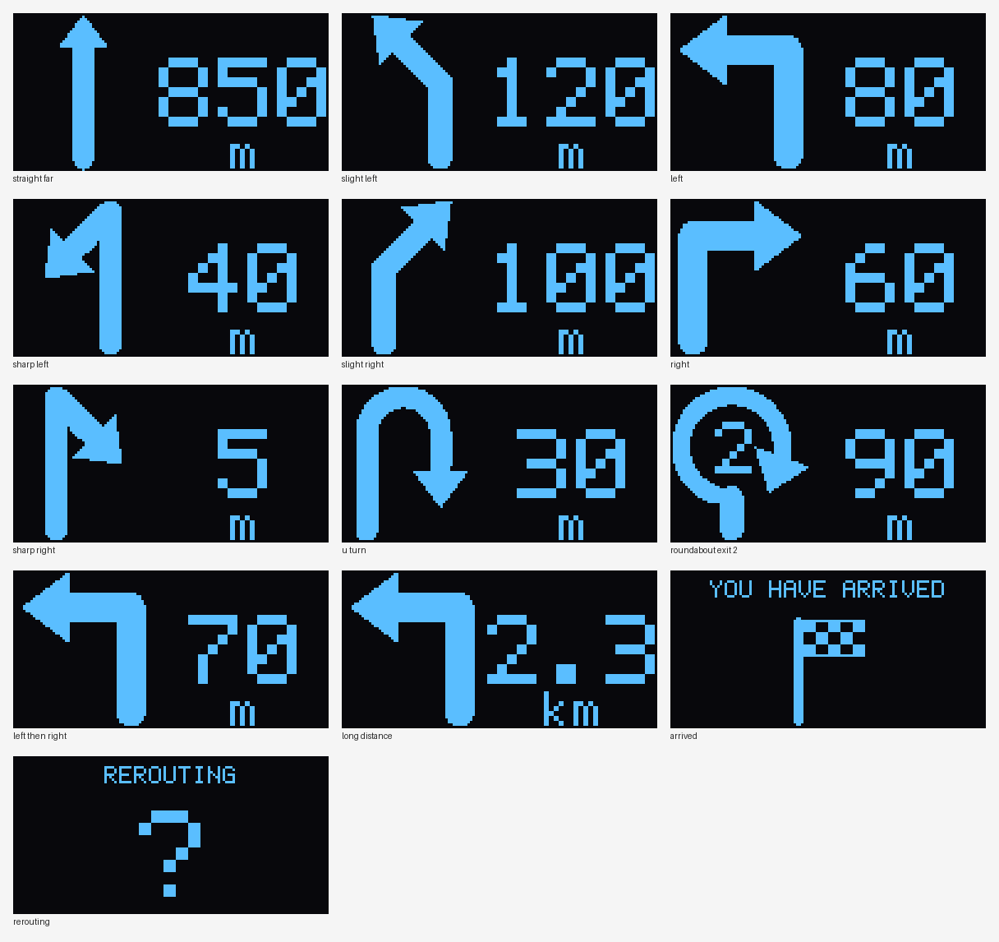

# Navigation, runs on phone (N)

Code: `phone/navigation/` is a plain Dart package (no Flutter imports), so it can be tested on a laptop. The Flutter app imports it, feeds it GPS fixes from `geolocator`, and sends the display symbol IDs, distance and flash flag it returns to the front module.

| ID | Task | Depends on | Output | Status |
|----|------|-----------|--------|--------|
| N1 | Compare mapping APIs for cycling routes in Ireland | None | **OpenRouteService** chosen (comparison below); manoeuvre list mapped in `ors_client.dart` | Done, still needs a test call with our own key |
| N2 | Level 1: current location, request route, output next manoeuvre | N1, P3 | `OrsClient.route()` + `NavigationEngine` in `TriggerMode.always` | Done |
| N3 | Level 2: show the manoeuvre within 100 m, measured along the route, allowing 5-10 m GPS error | N2 | `TriggerMode.distance` (default). Shows at 100 m + 10 m GPS margin, stays shown once shown, moves on 10 m after the turn | Done |
| N4 | Level 3: show the manoeuvre once the rider passes the last junction before the turn | N3 | `TriggerMode.junction` + `junctions.dart`. Junctions come from OpenStreetMap through the Overpass API. Falls back to Level 2 if there's no junction or no data | Done, live Overpass call not yet tested |
| N5 | Off-route detection and automatic rerouting | N2 | Off-route = more than 30 m (+ GPS accuracy, capped at 20 m) from the route for 3 fixes in a row. `NavigationSession` then requests a new route from the current position, at most once every 15 s. Matrix shows "rerouting" meanwhile | Done |
| N6 | Mapping table from provider manoeuvre type to display symbol ID | N1, F2 | `symbols.dart` and the table below. The display is now a 128x64 OLED; screens are drawn by `oled.dart` | Done, F2 must use the same IDs and layout |
| N7 | Test harness that replays a recorded or simulated GPS track | N2 | `bin/replay.dart` (GPX file or simulated noisy ride), plus 28 unit tests | Done |

## N1: mapping provider comparison

| Provider | Cycling mode | Free tier | Manoeuvre types | Roundabout exit number | Notes |
|---|---|---|---|---|---|
| **OpenRouteService** | `cycling-regular`, `cycling-road`, `cycling-electric`, `cycling-mountain` | 2,000 routes/day, 40/min, no card | 14 numeric codes (0-13): left, right, sharp left/right, slight left/right, straight, enter/exit roundabout, U-turn, goal, depart, keep left/right | **Structured** (`exit_number`) | OpenStreetMap data, so cycle lanes and greenways in Dublin are well covered |
| Mapbox Directions | `cycling` | 100,000 requests/month | `type` (turn, merge, fork, roundabout, rotary, end of road, ...) + `modifier` (left, slight left, sharp left, uturn, ...) | **Structured** (`exit`) | Needs a Mapbox account. Its own map style would duplicate our Google Maps display |
| GraphHopper | `bike` | Free plan with a small daily credit limit | `sign` codes -8 to 8 (U-turns, keep, sharp/slight turns, roundabout) | **Structured** (`exit_number`) | Free plan limit is tight for testing |
| OSRM | `bike` only on self-hosted or community servers | Free, but the community server forbids heavy or app use | Same format as Mapbox | **Structured** (`exit`) | Would need our own server |
| Google Routes API | `BICYCLE` | Monthly free allowance, billing account required | `TURN_LEFT`, `TURN_SLIGHT_LEFT`, `TURN_SHARP_LEFT`, `UTURN_LEFT`, `ROUNDABOUT_LEFT`, `STRAIGHT`, `MERGE`, `FORK_*`, `RAMP_*`, ... | **Text only** ("take the 2nd exit"), so it would have to be parsed out of the instruction | Check cycling coverage in Ireland before relying on it |

**Decision:** OpenRouteService for routing. It has a cycling profile, a free tier with no card, and the roundabout exit number as a structured field. The app keeps Google Maps (`google_maps_flutter`) to draw the map and Google Places for destination search (P3). The route line from ORS is drawn on the Google map.

Prices and limits change, so recheck them when signing up. Keep the ORS key out of GitHub (pass it with `--dart-define=ORS_API_KEY=...`, the same approach as the OpenAI key in C1).

## Handlebar display (replaces the 8x8 LED matrix)

The front module now uses a **0.96" 128x64 OLED** (SSD1306 controller, I2C, usually address `0x3C`). **Buy the Blue (or White) version, not Yellow Blue.** On the yellow/blue one, the top 16 rows can only ever light up yellow, so the top of every arrow would be yellow.



Layout:
- **Left (57 x 64):** the arrow, as big as possible. Each arrow is measured and scaled to fill the area: tall arrows use the full height, wide ones the full width. Its angle shows how sharp the turn is: straight 0°, slight 45°, normal 90°, sharp 135°. U-turns go round to the right (traffic keeps left in Ireland). The roundabout is a clockwise circular arrow with the exit number inside.
- **Right:** distance to the turn, rounded like a bike computer: `87 m`, `120 m` (to 10 m above 100 m), `2.3 km`.
- **No text label** on turn screens. Only the arrived, rerouting and no-phone screens have words.
- **Close turns:** only the next turn is shown. The one after it appears as soon as the rider passes the first.
- **Flash:** when the turn is **5 m** away or less (measured along the route), the screen inverts 4 times a second until the rider has passed the turn. The firmware does this with the SSD1306 invert command (`display.invertDisplay()` in the Adafruit library), so nothing needs redrawing. With phone GPS error of 5-10 m, the flash can start a few metres early or late.

`phone/navigation/lib/src/oled.dart` draws every screen pixel for pixel (`renderOled`), and the phone app previews exactly that. The ESP32 firmware in [`front-module/`](../front-module/README.md) draws the same screens itself from a small Bluetooth message (draft protocol in `protocol.dart`). `front-module/test_native/check.sh` confirms that the two match on 503 screens.

To regenerate the pictures: `dart run tool/oled_preview.dart out_dir` writes every screen as a PBM image.

## N6: symbol IDs

These IDs go over Bluetooth (S4). They say which screen to draw. The distance and the flash flag are sent alongside them.

| ID | Screen | Shown for (ORS step type) |
|----|--------|---------------------------|
| 0 | Blank | Not navigating |
| 1 | Straight on | Continue (6), and between turns before the trigger point |
| 2 | Turn left (90°) | Left (0) |
| 3 | Turn right (90°) | Right (1) |
| 4 | Slight left (45°) | Slight left (4), keep left (12) |
| 5 | Slight right (45°) | Slight right (5), keep right (13) |
| 6 | Sharp left (135°) | Sharp left (2) |
| 7 | Sharp right (135°) | Sharp right (3) |
| 8 | U-turn | U-turn (9) |
| 9 | Roundabout | Enter roundabout (7), followed by the exit number |
| 10 | Arrival | Goal (10) |
| 11 | Rerouting | Off-route (N5) |
| 12 | Bluetooth lost | Set by the front module itself |
| 13 | Low battery | Set by the module itself |
| 21-29 | Exit 1-9 | Roundabout exit number |

Not shown: depart (11) and exit roundabout (8), because the exit number is already on the enter-roundabout step.

A roundabout is sent as `[9, 2x]` (2nd exit = `[9, 22]`). Two turns 40 m or less apart are sent together, e.g. left then right = `[2, 3]`. The screen shows only the first; the app shows both.

## How the levels decide when to show a turn

All distances are measured **along the route**: GPS fixes are snapped onto the route line, never measured as a straight line to the turn.

- **Level 1:** the next turn is always shown.
- **Level 2:** the turn is shown from 110 m before it (100 m + 10 m GPS margin), so GPS error makes it slightly early rather than late. Once shown it stays on, even if GPS jitters backwards. The app moves on to the next turn once the rider is 10 m past this one, or halfway to the next turn if that is closer.
- **Close turns (any level):** if the next turn is 40 m or less after this one, both are shown together, so the rider knows about the second before reaching the first.
- **Level 3:** the turn is shown when the rider passes the last side road before it (a road node where 3 or more road arms meet in OpenStreetMap). Driveways, car parks and footpaths don't count. The turn's own junction is ignored. If there's no side road, or Overpass is unreachable, Level 2 is used instead.

## Testing without riding (N7)

```
cd phone/navigation
dart test
dart run bin/replay.dart --route test/fixtures/ors_sample.json
dart run bin/replay.dart --route my_route.json --gpx my_ride.gpx --mode junction
```

`my_route.json` is a saved ORS response and `my_ride.gpx` is any recorded ride. To test the full app on a phone, set the app as the mock location app (Developer options, Select mock location app), or use `adb emu geo fix <lon> <lat>` on the Android emulator.

## Still to do

- ~~Get an ORS key and make one real Dublin request.~~ Done: Trinity College to St Patrick's Cathedral (1.7 km) parsed correctly and is saved as `test/fixtures/dublin_trinity_to_st_patricks.json`. A route with a roundabout is still needed to check `exit_number`.
- Test the Overpass junction query from a laptop or phone. Both overpass-api.de and overpass.kumi.systems block the cloud build machine. Use `--overpass` on the replay tool to try another server.
- Record a real ride as GPX and replay it at all three levels to tune the 100 m, 10 m and 30 m values.
- Agree the symbol IDs and screen layout with whoever does F2, then copy them into the S4 protocol spec.
- Decide whether the module draws the screens itself or receives ready-made frames (part of S4).
